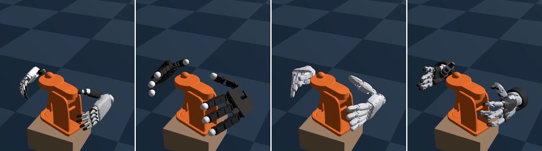
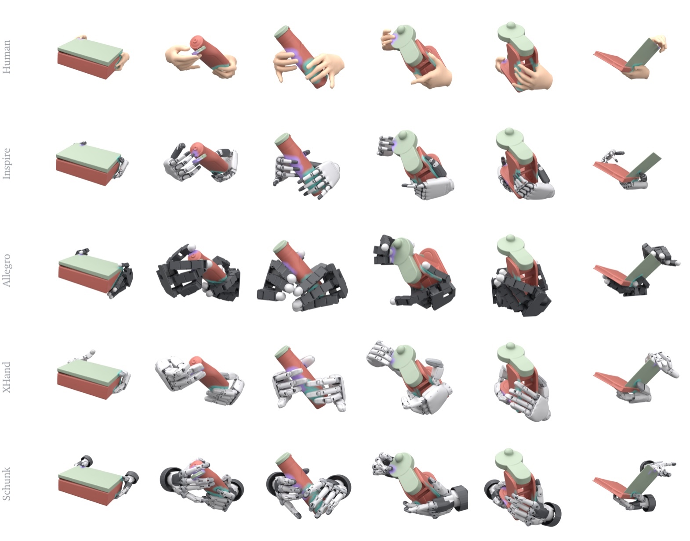
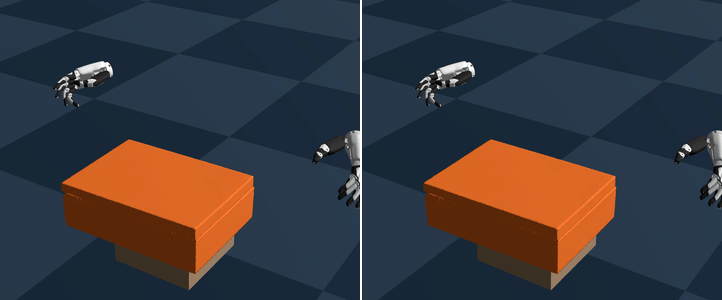
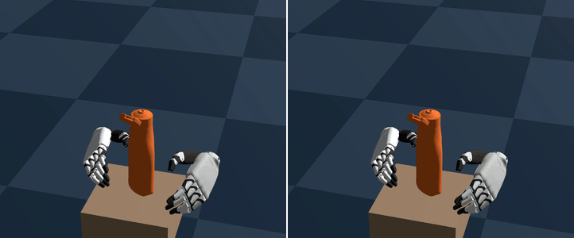

<div align="center">

<h1>DexDuet</h1>

<h3>Learning Contact-Preserving Bimanual Dexterity from Human Demonstrations</h3>

<a href="https://rcl-robotics.github.io/Dexduet.io/"></a>
<a href="https://arxiv.org/abs/2611.30495"></a>
<a href="LICENSE"></a>

🏆 <b>Industry Innovation Award</b> &nbsp;&nbsp;·&nbsp;&nbsp; 🥈 <b>2nd place, Track 2 (Robotic Grounding)</b><br>
<a href="https://nvidia-isaac.github.io/video_to_data/v2d_challenge/#leaderboard">NVIDIA Video to Data (V2D) Challenge</a>, CoRL 2026

<br>


</div>

<br>

DexDuet learns a bimanual robot policy from a single human demonstration and keeps the human's hand–object contacts.

Our entry to the NVIDIA V2D Challenge is built on DexDuet. The code for all three tiers is in
[RCL-Robotics/nv-v2d-hoi](https://github.com/RCL-Robotics/nv-v2d-hoi).

## Across robot hands

<p align="center"></p>
<p align="center"><sub>Inspire · Allegro · XHand · Schunk</sub></p>

<p align="center"></p>

## Compared with DexMachina

<table>
  <tr>
    <td align="center"><br><sub>Box-200</sub></td>
    <td align="center"><br><sub>Ketchup-100</sub></td>
  </tr>
  <tr>
    <td align="center"><br><sub>Ketchup-300</sub></td>
    <td align="center"><br><sub>Waffleiron-300</sub></td>
  </tr>
</table>
<p align="center"><sub>DexMachina (left), DexDuet (right), with Inspire hands.</sub></p>

## Method

<p align="center"></p>

## Results

| Hand | ADD-AUC ↑ | Contact-AUC ↑ |
|:--|:-:|:-:|
| Inspire | 52.5 → **88.7** | 33.6 → **79.6** |
| Allegro | 65.8 → **94.8** | 35.8 → **68.0** |
| XHand | 60.7 → **93.6** | 38.2 → **79.5** |
| Schunk | 73.7 → **94.1** | 45.2 → **80.4** |

<sub>DexMachina → DexDuet on the DexMachina suite, 7 demonstrations × 5 seeds. The paper also reports the SPIDER suite, the ManipTrans suite and the V2D challenge.</sub>

## Get started

```bash
bash scripts/reproduce.sh setup                                # environments, patched Genesis
bash scripts/reproduce.sh download-arctic                      # ARCTIC, MANO, SMPL-X (your accounts)
bash scripts/reproduce.sh prepare                              # retarget the demonstrations
conda activate dexmachina

CUDA_VISIBLE_DEVICES=0 python scripts/train_coordinates_hand.py --task Box-200   # train and evaluate
bash scripts/reproduce_paper.sh from-release --suite main      # main table from our checkpoints
```

[Checkpoints](https://huggingface.co/oldTOM/dexduet-checkpoints) · [Reproduce the DexMachina-suite tables](REPRODUCE.md) · [Flags and layout](docs/DETAILS.md) · [G1 + Dex3 study](https://github.com/HaoranZhangumich/DexDuet-V2D) · [V2D Challenge, all three tiers](https://github.com/RCL-Robotics/nv-v2d-hoi)

## Acknowledgement

Built on [DexMachina](https://github.com/MandiZhao/dexmachina); thanks to its authors for releasing their code, assets
and checkpoints. MIT license, inherited from DexMachina. The ARCTIC object meshes in `dexmachina/assets/arctic/` and the
MANO hand assets in `dexmachina/assets/mano_hand/` come from DexMachina's repository; the terms of
[ARCTIC](https://arctic.is.tue.mpg.de/) and [MANO](https://mano.is.tue.mpg.de/) apply to them.

## Citation

```bibtex
@article{zhang2026dexduet,
  title   = {DexDuet: Learning Contact-Preserving Bimanual Dexterity from Human Demonstrations},
  author  = {Zhang, Haoran and Ding, Haokai and Zhou, Han and Lu, Zuxing and Zhang, Heng and Zuo, Xingxing},
  journal = {arXiv preprint arXiv:2611.30495},
  year    = {2026}
}
```

Please also cite DexMachina:

```bibtex
@inproceedings{mandi2026dexmachina,
  author    = {Zhao Mandi and Yifan Hou and Dieter Fox and Yashraj Narang and Ajay Mandlekar and Shuran Song},
  title     = {{DexMachina}: Functional Retargeting for Bimanual Dexterous Manipulation},
  booktitle = {International Conference on Machine Learning (ICML)},
  year      = {2026},
}
```
