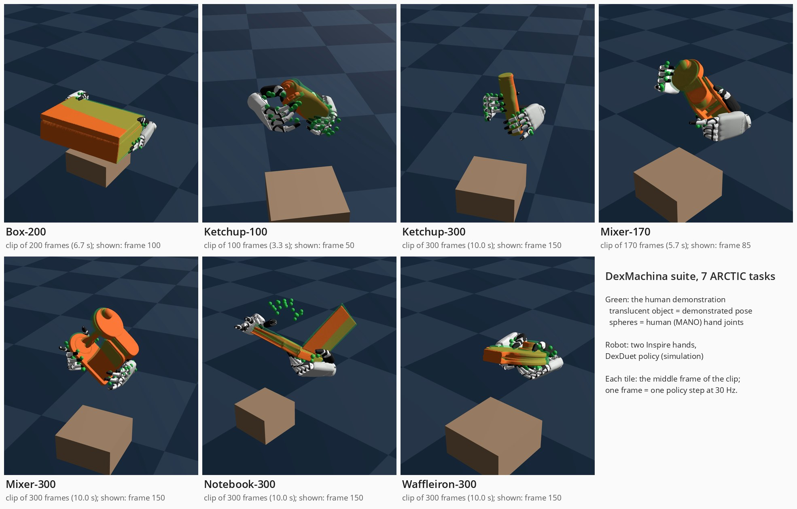

# DexDuet: details

The [README](../README.md) has the overview, the results and the commands; this page has the rest. [REPRODUCE.md](../REPRODUCE.md) maps each result of the paper to its commands.

- [Tasks](#tasks)
- [Built on DexMachina](#built-on-dexmachina)
- [What DexDuet adds](#what-dexduet-adds)
- [Rollouts](#rollouts)
- [Installation](#installation)
- [Quick start](#quick-start)
- [Repository layout](#repository-layout)

## Tasks



The 7 ARCTIC tasks of the DexMachina suite, middle frame of each clip: two Inspire hands driven by DexDuet in simulation,
with the human demonstration in green (translucent object = demonstrated object pose, spheres = MANO hand joints); the
paper also reports Allegro, XHand and Schunk hands.

## Built on DexMachina

This repository is a modified fork of [DexMachina](https://github.com/MandiZhao/dexmachina)
([paper](https://arxiv.org/abs/2505.24853), [project page](https://project-dexmachina.github.io)) by Zhao Mandi,
Yifan Hou, Dieter Fox, Yashraj Narang, Ajay Mandlekar and Shuran Song. We thank the authors for releasing their code,
their hand and ARCTIC assets, their task configurations and their checkpoints, on which this work is built. DexDuet keeps
DexMachina's simulator setup, retargeting, task suite, reward terms and weights (including its contact reward), PPO
settings, stopping rule and checkpoint selection, and adds the parts below. If you use this code, please also cite
DexMachina.

## What DexDuet adds

| Part | What it does | Flags |
|---|---|---|
| Per-hand policy | The bimanual policy is split into two per-hand policies that share one actor network. Each hand's actor sees its own observation and the other hand's state and previous action. PPO clips each hand's probability ratio separately, with advantages from two value heads of a shared critic. | `--coordinate_actor --per_hand_ppo --value_mode per_hand` (with `--ablation_protocol dexmachina`, which per-hand PPO needs) |
| Assisted reference-state initialization (A-RSI) | Episodes start throughout the demonstration. Each start segment has its own level of object assistance, which is withdrawn as episodes from that segment succeed. Mid-demonstration episodes start from simulator states that earlier episodes reached, segments where episodes fail are drawn more often, and a quarter of the starts are forced to the first frame. | `--curr_schedule rsi --rsi_keyframes --rsi_grace_bank 8 --rsi_kf_confirm 30 --rsi_kf_to_end --rsi_frame0_share 0.25` |
| Hand graph reward | Each hand's palm and finger directions and fingertip gaps, compared with the human hand in the object frame (weight 0.5). | `--hand_graph_weight 0.5` |
| Hand-object contact reward | For the palm and each finger of each hand: the distance to each object part and the closest point on it, compared with the human hand (weight 1.0). | `--ho_contact_weight 1.0` |
| Contact-AUC | An evaluation metric: in every window in which a human hand holds an object part without sliding, it checks whether the same robot hand touches that part without sliding on it. | `dexmachina/eval/slip_record.py`, `slip_auc.py` |

`scripts/train_coordinates_hand.py` sets all of these. "Coordinates Hand" was the project's working name; it survives in
this file name and in the default run names. [docs/METHOD.md](METHOD.md) describes the method in the code's terms and maps
the code's names to the paper's.

**Hands.** Inspire (default), Allegro, XHand and Schunk, as in the paper, through `--hand`. Both interaction rewards follow
each hand's finger correspondence from its retargeting, so a hand with fewer fingers than the human's uses only the
matched fingers. Configurations for Dex3, Ability and DexRobot hands are in the code,
without results.

## Rollouts

The README shows DexMachina (left, the authors' released checkpoint) and DexDuet (right) with Inspire hands on four
tasks.

- **Runs.** On Box-200 and Ketchup-100, each method's median of the 5 training seeds by scored ADD-AUC; on Ketchup-300
  the best of the 5 for both methods, because the median DexDuet run drops the bottle in the last frames (all 5
  DexMachina runs drop it early). Scored ADD-AUC (%), DexMachina vs DexDuet: Box-200 88.9 vs 96.1, Ketchup-100 77.8 vs
  89.9, Ketchup-300 7.6 vs 89.8.
- **Four hands.** Mixer-300, the 300-frame demonstration with the highest worst-hand median ADD-AUC; each hand's median
  DexDuet run.
- **What is shown.** Lane 0 of the scored 100-lane evaluation, identical to the scored rollout. Both panels share the
  start state and the camera.
- **Speed.** Whole clips in real time: one policy step per frame of the 30 Hz ARCTIC capture, every 2nd step shown at
  15 frames per second.

## Installation

[docs/SETUP_NEW_MACHINE.md](SETUP_NEW_MACHINE.md) covers a new Linux GPU machine end to end. In short:

```bash
git clone https://github.com/HaoranZhangumich/DexDuet.git && cd DexDuet
bash scripts/reproduce.sh setup            # conda environments dexmachina and arctic_env; Genesis with the overflow patch
bash scripts/reproduce.sh download-arctic  # licensed ARCTIC, MANO and SMPL-X data, with your own accounts
bash scripts/reproduce.sh prepare          # process ARCTIC, retarget the hands, map contacts
conda activate dexmachina
python scripts/preflight.py --stage train --hands inspire_hand
```

DexDuet also needs the MANO hand vertices of the demonstrations and the contact reward's assets (REPRODUCE.md, section 1).
The Genesis patch fixes a collision-pair buffer overflow in which one parallel environment's contacts could overwrite
another's ([docs/METHOD.md](METHOD.md), section 4).

## Quick start

```bash
python scripts/train_coordinates_hand.py --task Ketchup-300 --dry-run          # print the exact training command
CUDA_VISIBLE_DEVICES=0 bash scripts/reproduce_paper.sh main --task Box-200 --seed 15 --smoke   # 20 updates, then the full evaluation
CUDA_VISIBLE_DEVICES=0 bash scripts/reproduce_paper.sh main --task Box-200 --seed 15           # full training run
CUDA_VISIBLE_DEVICES=0 bash scripts/reproduce_paper.sh evaluate --run <run folder> --task box-200 --seed 15
```

Tasks: `Box-200`, `Ketchup-100`, `Ketchup-300`, `Mixer-170`, `Mixer-300`, `Notebook-300`, `Waffleiron-300`. Every
evaluation follows the paper's protocol (100 rollouts, evaluation seed 1042, patched Genesis, first observation read from
the simulator) and reports ADD-AUC, SP-SR, MP-SR, MPPE and Contact-AUC.

## Repository layout

| Path | What |
|---|---|
| `dexmachina/envs/` | environment, rewards (including the hand graph and hand-object contact rewards), A-RSI (`curriculum.py`, `keyframes.py`) |
| `dexmachina/rl/` | training (`train_rl_games.py`, `final_checkpoint.py`), the per-hand network and PPO (`coordinate_network_builder.py`, `per_hand_ppo.py`, `ablation_ppo.py`), evaluation (`eval_rl_games.py`) |
| `dexmachina/eval/` | ADD-AUC (`compute_add.py`), Contact-AUC (`slip_record.py`, `slip_auc.py`), the hold test (`hold_test/`) |
| `scripts/` | training launcher, paper reproduction (`reproduce_paper.sh`), checkpoint download and staging, environment setup |
| `baselines/` | the ablation rows (`ablation_rows.py`, `run_all.sh`) and SP-SR, MP-SR and MPPE (`track2_metrics.py`) |
| `docs/` | method notes, machine setup, trainer options, DexMachina's own reproduction |
| `environment/` | pinned source revisions, environment files, the Genesis patch |
